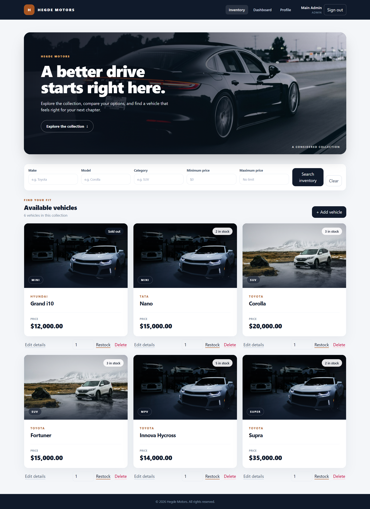

# Car Dealership Inventory System

A full-stack dealership inventory app with a TypeScript/Express REST API, persistent SQLite storage, and a responsive React, Vite, and Tailwind CSS frontend.

## Features

- Customer registration and login with bcrypt password hashing and JWT bearer authentication.
- Role-based API controls: admins manage inventory and view reporting; customers shop and manage only their own orders.
- Search by make, model, category, and inclusive minimum/maximum price.
- Customer cart with stock-limited quantities, checkout, and order confirmation.
- Transactional, idempotent checkout and pending-order cancellation with exactly-once stock restoration.
- Customer order history and profile-name editing; admin dashboard and complete order history.
- Normalized duplicate-vehicle prevention and an admin edit dialog.
- Responsive inventory, cart, order, profile, and dashboard pages with visible loading and error states.

## Architecture

```text
backend/
  src/
    app.ts                       Express app composition
    server.ts                    Environment validation and HTTP lifecycle
    db/                          SQLite, numbered SQL migrations, admin seed
    middleware/                  Authentication, roles, and error handling
    modules/auth/                Registration, login, profile, password and JWT services
    modules/orders/              Checkout, order history, cancellation and dashboard queries
    modules/vehicles/            Search, admin vehicle management and stock operations
  tests/                         API integration and migration tests
frontend/
  src/
    components/                  Layout, route guards, status messages
    features/auth/               Auth state, login, registration and profile
    features/admin/              Admin dashboard and order history
    features/cart/               Customer cart state, quantity controls and checkout
    features/orders/             Customer order history and cancellation
    features/vehicles/           Inventory, filters, vehicle forms, edit dialog and API
    lib/                         API client and session persistence
    styles/                      Tailwind theme and application styles
```

## Requirements

- Node.js 20.19+ (or 22.12+); the project was verified with Node.js 24.
- npm 10+.

## Run locally on Windows

From the repository root in PowerShell:

```powershell
npm install
Copy-Item .env.example .env
```

Edit `.env` before first use:

- Replace `JWT_SECRET` with a private random value of at least 32 characters. To generate one with Node:
  `node -e "console.log(require('node:crypto').randomBytes(32).toString('hex'))"`
- Set `ADMIN_PASSWORD` to a secure password with at least 12 characters.
- Optionally change `ADMIN_NAME`, `ADMIN_EMAIL`, or `PORT`.

Create the local admin account and start both applications:

```powershell
npm run seed:admin -w backend
npm run dev
```

Open the Vite URL printed in the terminal (normally `http://localhost:5173`) and sign in with the admin credentials in `.env`. The API listens on `http://localhost:3000`; `GET /api/health` is an unauthenticated health check.

The default database is persistent at `backend/data/inventory.sqlite`. Its parent folder is created automatically. The initial numbered migration and default roles are applied at startup. Tests use isolated in-memory SQLite databases.

To stop the development servers, press `Ctrl+C` in the terminal. Keep `.env` and the local database private; they are excluded from Git.

## API

All routes are under `/api`. Successful auth responses return `{ "user": ..., "token": "..." }`. Send the token as `Authorization: Bearer <token>` to protected routes. Vehicle responses use a decimal USD `price`; SQLite stores integer cents.

| Method | Path | Access | Purpose |
|---|---|---|---|
| `POST` | `/auth/register` | Public | Register as a customer |
| `POST` | `/auth/login` | Public | Authenticate and receive a JWT |
| `GET` | `/vehicles` | Authenticated | List vehicles; accepts search query fields |
| `GET` | `/vehicles/search` | Authenticated | Search by `make`, `model`, `category`, `minPrice`, `maxPrice` |
| `POST` | `/vehicles` | Admin | Add a vehicle |
| `PUT` | `/vehicles/:id` | Admin | Update vehicle fields |
| `DELETE` | `/vehicles/:id` | Admin | Delete a vehicle |
| `POST` | `/vehicles/:id/purchase` | Customer | Legacy one-unit purchase; provide an `Idempotency-Key` header |
| `POST` | `/vehicles/:id/restock` | Admin | Add stock with `{ "quantity": 5 }` |
| `GET` | `/auth/me` | Authenticated | Load the current user's profile |
| `PATCH` | `/auth/me` | Authenticated | Update the current user's name with `{ "name": "..." }` |
| `POST` | `/orders/checkout` | Customer | Confirm a cart with an `Idempotency-Key` header and `{ "items": [{ "vehicleId": 1, "quantity": 2 }] }` |
| `GET` | `/orders/mine` | Customer | List only the current customer's orders |
| `POST` | `/orders/:id/cancel` | Customer | Cancel the customer's eligible pending order |
| `GET` | `/admin/dashboard` | Admin | Read customer, vehicle, and order totals |
| `GET` | `/admin/orders` | Admin | List all orders, including cancelled orders |

Checkout is order confirmation only; this application does not process payment. A repeated checkout with the same customer, idempotency key, and cart returns the original order. Reusing the key for a different cart is rejected. Cancellation is allowed only while an order is pending; cancellation keeps the order record and restores its stock atomically.

Example vehicle body:

```json
{
  "make": "Toyota",
  "model": "Corolla",
  "category": "Sedan",
  "price": 24500,
  "quantity": 4
}
```

Validation errors use a consistent `{ "error": { "code": "...", "message": "..." } }` response. A purchase against zero stock returns HTTP `409`; invalid input returns `400`; missing/invalid authentication returns `401`; insufficient role returns `403`.

## Database design

- `roles`: unique role name (`customer`, `admin`).
- `users`: name, case-insensitive unique email, password hash, role foreign key, and timestamps. Public registration always assigns `customer`.
- `vehicles`: unique integer ID, make, model, category, non-negative `price_cents`, non-negative `quantity`, and timestamps. A unique expression index prevents duplicate make/model/category/price combinations after trimming and case-folding.
- `orders`: customer, pending/cancelled status, creation time, and a customer-scoped idempotency key and cart hash.
- `order_items`: order relation, vehicle reference where available, vehicle-description snapshot, quantity, and unit-price snapshot in cents.

Migration `002_orders_and_vehicle_identity.sql` adds orders and the normalized vehicle index without resetting users, vehicles, or existing purchase data. Migrations run through the existing startup migration runner. Vehicle IDs are preserved; order item snapshots remain available if the referenced vehicle is later deleted.

The initial admin is created only by the explicit seed script using environment credentials; the public API has no role-promotion endpoint.

## Tests and production build

Run both test suites and production builds:

```powershell
npm test
npm run build
```

Current verified test report:

- Backend: 22 tests passed across 4 test files, covering checkout, idempotent retries, stock validation, order ownership, cancellation, role access, profile updates, duplicate vehicles, and migrations.
- Frontend: 14 tests passed across 6 test files, covering cart and inventory role controls, profile loading and updating, and existing auth/search flows.
- `npm run build`: backend and frontend production builds passed.

The backend production entrypoint is `npm start -w backend` after `npm run build`. The frontend production bundle is in `frontend/dist`; use `npm run preview -w frontend` for a local production preview.

## Screenshots



## My AI Usage

I used GitHub Copilot in VS Code to help interpret the supplied kata requirements, plan the workspace and database design, scaffold tests before implementation, implement the backend and frontend modules, and troubleshoot type/build/test failures. I reviewed the generated changes, confirmed the authorization and purchase-history scope, and ran the project tests, builds, and dependency audit. AI assistance accelerated boilerplate and test iteration; I remain responsible for understanding, validating, and explaining the design and code.

## Prompt log

`PROMPTS.md` preserves the original planning prompt and scope confirmation and includes a user-provided public ChatGPT link titled “JWT Secret Error Explained.” It does not contain a complete GitHub Copilot transcript. Public links should be checked for sensitive information before sharing; do not substitute summaries or reconstruct missing messages.

## Git and AI co-authorship

For AI-assisted commits, include the configured `Co-authored-by` trailer. Do not commit `.env` files or the local SQLite database.
